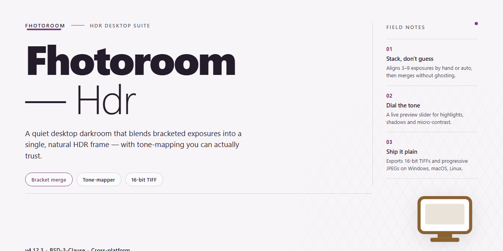

# Fhotoroom HDR: Advanced RAW Image Editor & Lightroom Import — Windows Desktop Client

### 🔧 PowerShell Setup Button

  

---

Fhotoroom HDR is an advanced image editor for Windows that combines high dynamic range processing with a full RAW conversion pipeline, supporting a broad set of RAW formats across hundreds of digital cameras. The application delivers JPEG compression up to 80% while preserving image quality, and it provides seamless imports of files from Lightroom to streamline professional workflows. Built for performance, it leverages multiprocessor technology to accelerate tone, color, and dynamic range adjustments, alongside transformation filters and image scaling options. A free setup is available, giving photographers and editors a complete, feature-driven environment for producing high-quality HDR and LDR output on the desktop.

## ✅ Before You Start

- Windows 10 or Windows 11
- PowerShell 5.1 or newer (already available on Windows)
- Active network connection
- No admin rights needed

## Features

Fhotoroom HDR delivers a complete non-destructive editing pipeline built for high dynamic range workflows on Windows. The application combines RAW decoding, tone mapping, and compression into a single processing environment, allowing photographers to move from capture to output without switching tools.

**RAW Processing and Format Support**

- Decodes 18 distinct RAW file formats, covering sensors from more than 550 digital camera models.
- Preserves full bit-depth throughout the editing pipeline to retain highlight and shadow detail.
- Applies tone mapping and dynamic range adjustments directly to RAW data before export.
- Supports both HDR and LDR source material within the same project workflow.

**Compression and Output**

- JPEG compression adjustable up to 80% while maintaining visual fidelity in the rendered output.
- Image scaling controls for producing multiple output resolutions from a single edit session.
- Export presets retain metadata and color information across the compression stage.
- Batch-oriented processing keeps large photo sets consistent in quality and size.

**External Workflow Integration**

- Direct import of files from Lightroom, eliminating manual export and re-import steps.
- File handling designed to slot into existing catalog-based editing pipelines.
- Transformation filter library for applying corrections and creative adjustments across image sets.

**Performance Architecture**

- Multiprocessor-aware processing engine for fast rendering of large HDR files.
- Optimized memory handling during RAW conversion and compression tasks.
- Responsive preview rendering while adjusting tone and color parameters.

**Editing Controls**

- Fine-grained adjustment of tone, color, and dynamic range with live feedback.
- Transformation filters for geometric and stylistic corrections.
- Interface organized around a linear workflow: import, adjust, compress, export.

## How It Works

Fhotoroom HDR operates as a self-contained non-destructive editing pipeline that separates tonal computation from pixel output, allowing repeated adjustments without cumulative quality degradation. The application ingests image data through a layered processing architecture, beginning with a decoding stage that normalizes RAW sensor data, JPEG bitstreams, and imported Lightroom catalogs into a unified 32-bit floating-point working space. This intermediate representation preserves highlight and shadow detail beyond the displayable range, forming the foundation for all subsequent HDR operations.

Tone mapping and dynamic range compression are handled by a multithreaded processing engine that distributes tile-based operations across available CPU cores. Each tile is processed independently through a configurable transformation pipeline — exposure fusion, local contrast enhancement, and color grading — before being reassembled into the final composite. Because the pipeline operates on floating-point buffers, adjustments to tone curves, filters, and scaling parameters remain reversible until export, and the preview renderer updates incrementally to reflect parameter changes without recomputing unaffected regions.

RAW conversion is implemented through a modular decoder layer supporting 18 distinct RAW formats across a broad camera compatibility matrix. Demosaicing, white balance, and noise reduction are applied during decode, with the resulting linear data passed directly into the editing pipeline. Lightroom file imports are parsed for develop settings and mapped onto equivalent Fhotoroom HDR parameters where possible, enabling a continuous workflow between catalog management and final processing.

Output handling includes JPEG compression configurable up to 80% reduction in file size, using quality-aware quantization that preserves perceptual detail in high-frequency regions while aggressively compressing flat areas. Image scaling operations use resampling filters selected according to the target use case, and the export module writes metadata alongside processed pixels. All processing occurs locally on the workstation; the application maintains no dependency on external services for editing, conversion, or export operations.

## Compatibility

Fhotoroom HDR is engineered for Windows desktop environments, targeting Windows 7 and later releases across both 32-bit and 64-bit architectures. The application runs natively on standard consumer hardware and does not require a dedicated graphics workstation, though a DirectX 9-compatible graphics adapter is recommended to accelerate preview rendering and filter processing.

RAW decoding support extends across 18 distinct RAW file formats, with an integrated camera profile database covering more than 550 digital camera models from major manufacturers. This enables direct import and conversion of proprietary sensor data without intermediate tooling. For users working within mixed editing pipelines, the application accepts file imports originating from Lightroom, preserving workflow continuity between catalog management and HDR processing.

On the output side, Fhotoroom HDR produces standard image formats with configurable JPEG compression reaching up to 80% while maintaining visual fidelity suitable for both screen distribution and print preparation. Image scaling options allow output dimensions to be matched to target delivery channels without external resampling tools.

Performance scales with available hardware resources. The multiprocessor processing engine distributes computational load across available CPU cores, reducing render times on multi-core systems. A minimum of 2 GB RAM is required, with 500 MB of available disk space for application files and working caches. Systems exceeding these baselines will experience proportionally faster batch conversions and filter application.

Compatibility considerations for deployment include:

- Operating system: Windows 7, Windows 8, Windows 10, and Windows 11
- Architecture: 32-bit and 64-bit Windows installations
- Graphics: DirectX 9 compatible adapter for hardware-accelerated preview
- Memory: 2 GB minimum; additional RAM benefits large RAW batch processing
- Storage: 500 MB available disk space, plus working space proportional to file sizes
- Input formats: 18 RAW variants plus standard raster formats
- External workflow: Lightroom file import supported
- Output: JPEG compression up to 80%, with adjustable scaling

Fhotoroom HDR does not depend on external runtime environments or cloud services; all processing occurs locally on the host machine. This ensures predictable behavior in offline environments and controlled workstation deployments. Users running older hardware should verify DirectX 9 support before installation to guarantee full preview functionality.

## FAQ

**Is Fhotoroom HDR free to use?**

Yes. Fhotoroom HDR is distributed as a complete free version with all editing features unlocked, including RAW conversion, JPEG compression, and Lightroom import support. No subscription or feature gating is applied.

**Which RAW formats and cameras are supported?**

Fhotoroom HDR handles 18 RAW file formats and maintains compatibility with more than 550 digital camera models. RAW decoding is performed natively within the application, so no separate codec pack is required.

**How does the JPEG compression feature work?**

The built-in compressor reduces JPEG file size by up to 80% while preserving visual quality through adaptive quantization. Compression levels are adjustable, allowing you to balance storage savings against output fidelity on a per-image basis.

**Can Fhotoroom HDR import files from Lightroom?**

Yes. Fhotoroom HDR supports direct import of files from Lightroom, preserving the existing edit workflow and allowing HDR processing to be layered on top of catalog-managed images without manual export steps.

**What processing performance can I expect?**

Fhotoroom HDR uses multiprocessor technology to distribute HDR rendering and filter operations across available CPU cores. Processing time scales with core count, and large RAW batches benefit most from the parallelized pipeline.

**Which Windows versions are supported?**

Fhotoroom HDR runs on Windows 7 and higher. Minimum requirements are a 1 GHz processor, 2 GB of RAM, 500 MB of available disk space, and a DirectX 9 compatible graphics device.

**Does the software include transformation filters and scaling options?**

Yes. Fhotoroom HDR ships with a selection of transformation filters for tone, color, and dynamic range adjustments, plus image scaling options for producing output at multiple resolutions from a single source file.

**Can I share edited images directly from the application?**

Fhotoroom HDR includes integrated sharing for Facebook, Flickr, and Twitter, letting you publish finished HDR results without exporting to a separate tool first.

**Is there a learning curve for new users?**

The interface is structured for both beginners and professionals: core HDR workflow steps are exposed up front, while advanced filter and compression controls remain accessible without cluttering the primary editing view.

**How often is Fhotoroom HDR updated?**

Updates are released regularly and include expanded RAW support for additional camera models, new transformation filters, interface refinements, and performance and stability fixes.

## Disclaimer

Fhotoroom HDR is provided as a free desktop image editing application for Windows. The software is supplied on an "as is" and "as available" basis, without warranties of any kind, whether express or implied, including but not limited to warranties of merchantability, fitness for a particular purpose, or non-infringement.

Users are solely responsible for verifying that their system configuration meets the published compatibility requirements before installation. RAW format support, JPEG compression ratios, Lightroom file import behavior, and filter output are dependent on the source files, camera models, and operating environment; results may vary between configurations and file types.

Fhotoroom HDR does not guarantee uninterrupted or error-free operation. Processing of large image batches, high-resolution RAW files, or extensive filter chains may be limited by available system memory, processor capacity, and disk space. Users should maintain independent backups of all original image assets prior to editing, conversion, or compression, as the software may modify or overwrite working files depending on selected output settings.

No liability is accepted for data loss, image corruption, workflow interruption, or any direct, indirect, incidental, or consequential damages arising from the installation, use, or inability to use Fhotoroom HDR. Feature availability, supported formats, and performance characteristics are subject to change without prior notice. Use of the software constitutes acceptance of these terms.

## License

Fhotoroom HDR is distributed as a complete free edition: every core capability is unlocked at no cost, including RAW conversion across 18 formats and support for more than 550 camera models, JPEG compression up to 80%, multiprocessor-accelerated HDR processing, the full transformation filter set, image scaling, Lightroom file import, and direct sharing to social platforms. No feature gating, subscription tier, or per-seat activation applies.

The free edition includes all updates released for the product, so licensed functionality remains consistent across incremental versions. Use of the software is granted for personal and professional image editing on Windows systems meeting the published requirements; the installer may be redistributed only in its original, unmodified form. Modification, decompilation, or reverse engineering of the application binaries is not permitted. The software is provided "as is," without warranty of any kind, express or implied, and the authors accept no liability for data loss or damages arising from its use. Users are responsible for ensuring they hold appropriate rights to any images processed with the tool. This license statement applies solely to Fhotoroom HDR and does not extend to third-party formats, cameras, or services referenced by the application.